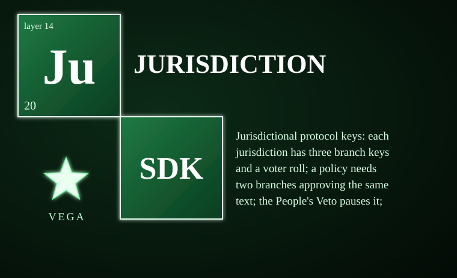

# vega-jurisdiction-sdk



Jurisdictional protocol keys: each jurisdiction has three branch keys and a voter roll; a policy needs two branches approving the same text; the People's Veto pauses it; the Kronos root changes only with consent from two thirds of the member jurisdictions.

> **Licensing.** Source-available, not open source. Free for personal use; free for registered small businesses (under US$1M revenue and valuation); everyone else needs a commercial license (see LICENSE; for a commercial license write to jasonblasiak.ai.mail@gmail.com). Patent pending. Draft licence text, not yet reviewed by an attorney.

## Specifications

| Item | Value |
|------|-------|
| Version | 0.1.0 |
| Python | >=3.10 |
| Dependencies | cryptography>=42, vega-custody-sdk, vega-governance-jacket-sdk |
| Tests | 39 tests in 1 file, all passing |
| Status | BUILT: protocol, signing |

## End-to-end functions

1. **Register a jurisdiction** — The device owner signs a human commitment for the exact identity (country code, name, three branch public keys, voter roll). The SDK records the registration and returns a protocol key that commits to all four elements.
2. **Submit branch positions** — Each branch signs a position (sequence number, approve/deny, sorted unique rule list). A policy becomes active only when at least two different branches approve the identical rule digest.
3. **Open a veto** — A registered voter signs a veto opening with a nonce and closing time (60 seconds to 90 days). Only one veto can be live at a time per jurisdiction.
4. **Cast ballots** — Registered voters sign ballots (for, against, or lift). A veto passes when "for" ballots reach 51% of the registered roll (rounded up). "Lift" ballots are only accepted while a veto is in force.
5. **Override a veto** — All three branches must sign an override. This lifts the veto without changing the rules.
6. **Update the Kronos root** — Requires consent from two thirds of member jurisdictions, each providing signatures from at least two of its three branches. A jurisdiction under an active veto cannot consent.
7. **Gate check** — `check(country)` returns allowed only when an active policy exists and no veto is in force. Unknown jurisdictions are denied by default.

## Controls

| Entry point | What it does |
|-------------|--------------|
| `Jurisdictions.register(country, name, branches, roll, signed)` | Registers a new jurisdiction; requires the device owner's human commitment for exactly this identity. Returns the protocol key. |
| `Jurisdictions.submit_position(country, branch, seq, approved, rules, sig)` | Records a branch position. Sequence numbers must strictly increase per branch. Signature verified against that branch's key and the "position" domain. |
| `Jurisdictions.open_veto(country, opener, nonce, closes_at, sig)` | Opens a People's Veto. Opener must be on the voter roll. Window 60s–90d. Returns the vote ID. |
| `Jurisdictions.cast(country, vote_id, voter, choice, sig)` | Casts a ballot. Choice: "for", "against", or "lift". Voter must be on the roll. One ballot per voter per phase. |
| `Jurisdictions.override(country, vote_id, sigs)` | Overrides a veto in force. `sigs` must contain valid signatures from all three branches over the override domain. |
| `Jurisdictions.update_root(prev_root, genesis, members, consents)` | Updates the Kronos root. `prev_root` must match current. `consents` maps each member to dict of branch signatures (need ≥2 per member). Returns new root. |
| `Jurisdictions.protocol_key_of(country)` | Returns the protocol key for a registered jurisdiction. |
| `Jurisdictions.policy(country)` | Returns `{"active": bool, "digest": str|None, "rules": list}`. |
| `Jurisdictions.veto_status(country, vote_id)` | Returns one of: "OPEN", "PASSED", "FAILED", "RESOLVED:<reason>". |
| `Jurisdictions.vetoes_in_force(country)` | List of vote IDs currently in force. |
| `Jurisdictions.check(country, unknown="deny")` | The gate. Returns `{"allowed": bool, "reasons": list, "rules": list}`. Fail-closed: unknown jurisdictions refused unless `unknown="allow"`. |
| `signing.Holder()` | Generates a new Ed25519 key pair. Private key stays in the object. |
| `signing.Holder.sign(kind, payload)` | Signs a domain-separated message. Kind must be one of: position, veto_open, ballot, override, consent. |
| `signing.verify(public_hex, kind, payload, sig_hex)` | Verifies a signature. Never raises; returns False on any error. |

## What it CANNOT do

- It does not provide secret ballots — ballots are signed with the voter's public key and are linkable to that key.
- The voter roll is fixed at registration — roll updates are not built.
- It does not interpret rule text — rules are plain strings acted on by callers or other SDKs.
- No real government keys or rules are included — nothing here is legal advice.
- Not independently security-reviewed — crypto is plain software written for clarity, not expert-reviewed.
- Not production-hardened — reference implementation with tests, not hardened for production.
- Containment is process-level, not an OS sandbox.
- License matrix is policy, not legal advice.

## Platform support

| Platform | Support |
|----------|---------|
| Windows | Runs anywhere CPython 3.11+ runs. Pure Python, no POSIX-only code. |
| macOS | Runs anywhere CPython 3.11+ runs. |
| Linux | Runs anywhere CPython 3.11+ runs. |
| Android | No native mobile build is published. The SDK is pure Python and can run inside a Python runtime on Android (Termux) where that runtime supports its dependencies. |
| iOS | No native mobile build is published. The SDK is pure Python and can run inside a Python runtime on Apple platforms (BeeWare/Kivy) where that runtime supports its dependencies. |
| GPU/TPM/hardware keys | Not required. No hardware-dependent capabilities. |

## Standalone & unified install

**Standalone:** `pip install -e .` installs and runs alone with declared dependencies (`cryptography>=42`, `vega-custody-sdk`, `vega-governance-jacket-sdk`). It imports two family SDKs down-layer only: `vega_custody` (dag, ledger) and `vega_jacket` (humanauth, commit).

**Unified:** Registered in vega-umbrella-sdk's registry as layer "jurisdiction" (layer 1 authority). The umbrella resolves inter-SDK wiring. Registry entry verbatim:

```python
"jurisdiction": {"layer": 1, "requires": ["custody", "jacket"]}
```

## Diagnostic control

The published code provides:
- No console scripts (no CLI entry points in pyproject.toml).
- Read-only introspection: `protocol_key_of`, `policy`, `veto_status`, `vetoes_in_force`, `check`, `root`, `root_members`, `replay_rejected`.
- Fail-closed indicators: `check()` returns `{"allowed": False, "reasons": [...]} with reasons like "unknown_jurisdiction", "policy_not_active", "veto_in_force"`.
- No environment variables honored.
- Exit codes: not applicable (library, not a CLI).
- Log surfaces: none (silent on success, raises `JurisdictionRefused` on validation failure).

A diagnostic UI design for this layer exists in the Vega OS interface program; it is not shipped with this package.

## Fail-closed constraints & custom constraints

**Fail-closed points (module + function):**
- `signing.verify` — returns False on any malformed input, wrong key length, wrong sig length, invalid signature, unknown kind, or canonicalization failure. Never raises.
- `protocol._check_reg_shape` — rejects malformed registration shapes before any chain write.
- `protocol._v_register` — requires a valid human commitment on the chain for exactly this identity; refuses if commitment missing, wrong action, or wrong action_hash.
- `protocol._v_position` — requires valid branch signature over "position" domain; rejects replayed or out-of-order sequence numbers; rejects forged signatures from other branches or wrong kinds.
- `protocol._v_open` — requires opener on roll; valid signature over "veto_open"; window bounds enforced; only one live veto at a time.
- `protocol._v_ballot` — requires voter on roll; valid signature over "ballot"; choice must be "for"/"against"/"lift"; one ballot per voter per phase; "lift" only while veto in force; "for"/"against" only while veto open.
- `protocol._v_override` — requires all three branch signatures over "override" domain; only while veto in force and not resolved.
- `protocol._v_root` — requires prev_root match (no replay/fork); genesis 64-char hex; members sorted unique registered; consents from 2/3 members each with ≥2 branch signatures over "consent"; vetoed jurisdictions excluded.
- `protocol.Jurisdictions.check` — unknown jurisdiction denied by default; requires active policy (2+ branches same digest); requires no veto in force.
- `protocol.Jurisdictions._commit` — verify → write to chain → apply. If chain write fails, nothing changes (state not mutated).
- `protocol.Jurisdictions.__init__` replay — rebuilds state from chain, re-verifying every signature; forged/tampered entries increment `replay_rejected` and change nothing.

**Custom constraints:** This version publishes no user-defined constraint hooks; constraints are fixed by the module and the jurisdiction floor. The governing rule (from OWNER_DIRECTIVE §5): "User-defined constraints may be STRICTER than the legal minimum for the applicable jurisdiction, never looser. Jurisdictional legal minimums are defined by the jurisdiction registry (vega-jurisdiction-sdk); a custom constraint that would drop below a registered minimum is rejected at the gate."

> **Licensing.** Source-available, not open source. Free for personal use; free for registered small businesses (under US$1M revenue and valuation); everyone else needs a commercial license (see LICENSE; for a commercial license write to jasonblasiak.ai.mail@gmail.com). Patent pending. Draft licence text, not yet reviewed by an attorney.
